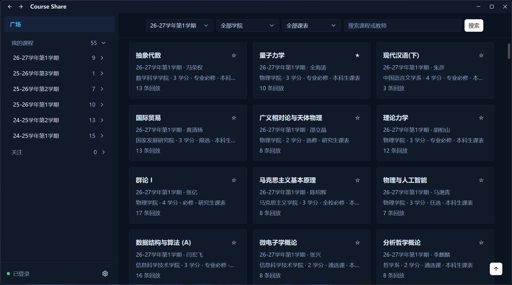
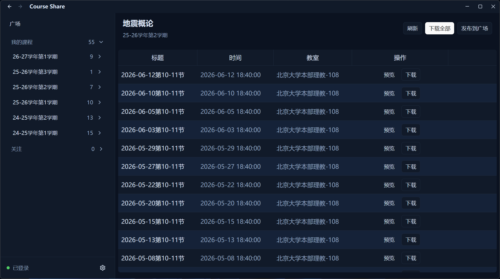

# Course Share

|课程广场|回放列表|
| ---- | ---- |
|||

下载任意课程回放，包括教学网上隐藏的、想听但没有选课的（如果教室录像没有启动，那就没办法了）

覆盖了近几个学期的所有回放，原则上你可以共享课程到广场，但现在已不主要依赖共享机制

## 使用

从 [release](https://github.com/dfshfghj/course-share/releases) 中下载并解压，运行`course-share`

## 开发

需要 Rust 1.99 或更高版本

```
cargo run              # 开发运行
cargo build --release  # 构建 release
```

另外需要 ffmpeg 用于转换 m3u8，要求 ffmpeg 在环境变量中，release 中带有 minimal 编译的 ffmpeg

---

感慨于树洞上大量有偿求回放的帖子，于是写了这个项目，希望能方便同学，减少倒卖行为吧